# Yuanchao Wu · 吴袁超

**From bytes to evidence.** I build native Rust systems for web and document intelligence, with statistical decision-making and hardware-aware execution.

[Website](https://aiseek.dev) · [LinkedIn](https://www.linkedin.com/in/yolow92) · [X](https://x.com/Ai__Seek) · [Try PageSift](#try-it--parse-a-page-from-this-profile)

## PageSift — the engine

[Source](https://github.com/YOLOW92/pagesift) · [crates.io](https://crates.io/crates/pagesift) · Local-first web capture, native parsing, provenance-tracked graphs, context compilation and claim resolution.

<picture>
  <source media="(prefers-color-scheme: dark)" srcset="assets/pagesift-dark.svg">
  
</picture>

<sub>Five chapters · 7 seconds per chapter · illustrative diagrams, not live benchmark traces.</sub>

## The stack — four algorithm studies

### yolow64

[Source](https://github.com/YOLOW92/yolow64) · [crates.io](https://crates.io/crates/yolow64) · Bit regrouping, AVX-512/AVX2/NEON, strict validation and cache-aware streaming. **101.4 GB/s** decode at 16 KiB on one Zen 5 core (repository benchmark).

<picture>
  <source media="(prefers-color-scheme: dark)" srcset="assets/yolow64-dark.svg">
  
</picture>

### yolowzstd

[Source](https://github.com/YOLOW92/yolowzstd) · [crates.io](https://crates.io/crates/yolowzstd) · Huffman pair lookup, SWAR, information-theoretic FSE and bounded optimal parsing. Safe Rust, zero runtime dependencies.

<picture>
  <source media="(prefers-color-scheme: dark)" srcset="assets/yolowzstd-dark.svg">
  
</picture>

### yolowhtml

[Source](https://github.com/YOLOW92/yolowhtml) · [crates.io](https://crates.io/crates/yolowhtml) · Spec-first HTML5, Markdown and statistical fallback extraction. **0.866 F1** on the WCXB 150-page test split.

<picture>
  <source media="(prefers-color-scheme: dark)" srcset="assets/yolowhtml-dark.svg">
  
</picture>

### yolowpdf

[Source](https://github.com/YOLOW92/yolowpdf) · [crates.io](https://crates.io/crates/yolowpdf) · Native document geometry, two-dimensional math and optional OCR with open BF16 models. v0.2.1 routes Accurate OCR to completed v3 text recognizers.

<picture>
  <source media="(prefers-color-scheme: dark)" srcset="assets/yolowpdf-dark.svg">
  
</picture>

### Other foundations

- [yolowdoc](https://github.com/YOLOW92/yolowdoc) · Office, ODF, EPUB, email, SQLite and archives → Markdown.
- [yolowsyntax](https://github.com/YOLOW92/yolowsyntax) · safe Rust tree-sitter runtime; 5,875 / 5,875 upstream corpus cases across 41 languages in its recorded benchmark.

## The mathematics underneath

Definitions, theorems and engineering models behind the implementations. The diagrams use small illustrative examples; the linked repositories are the source of implementation details and benchmark conditions.

<details>
<summary><b>PageSift · statistical decision-making and execution</b></summary>

**1. Thompson sampling** — acquisition strategy learns from outcomes. A Bernoulli/Beta model is the standard illustrative form:

```math
\theta\sim\operatorname{Beta}(\alpha+s,\beta+f)
```

Thompson (1933); see the [architecture](https://github.com/YOLOW92/pagesift/blob/main/docs/architecture.md) for per-family rendering decisions.

**2. Two-sided CUSUM** — unlike a Bayesian run-length posterior, the current detector accumulates deviations relative to the estimated segment mean:

```math
S_t^+=\max(0,S_{t-1}^++x_t-\mu-\Delta/2),\quad h=\frac{\sigma^2}{\Delta}\ln(1/\delta)
```

Page (1954), Hinkley (1971); [change detector](https://github.com/YOLOW92/pagesift/blob/main/crates/pagesift-stat/src/change.rs). Variance and mean are estimated online, so idealized false-alarm bounds are not universal guarantees.

**3. Universal Scalability Law** — fit contention and coherence costs from observed concurrency and throughput:

```math
X(N)=\frac{\lambda N}{1+\sigma(N-1)+\kappa N(N-1)},\quad N^*=\sqrt{(1-\sigma)/\kappa}
```

Gunther (2007); [online regression and confidence bound](https://github.com/YOLOW92/pagesift/blob/main/crates/pagesift-stat/src/usl.rs). The finite optimum requires positive coherence cost and a valid fit.

**4. Kaplan–Meier survival** — estimate survival with censored observations, rather than treating every unfinished operation as a failure:

```math
\widehat S(t)=\prod_{t_i\le t}(1-d_i/n_i)
```

Kaplan & Meier (1958); [survival statistics](https://github.com/YOLOW92/pagesift/blob/main/crates/pagesift-stat/src/survival.rs). The runtime also applies cgroup-aware admission and NUMA worker sizing; hardware limits are not learned probabilities.

</details>

<details>
<summary><b>yolow64 · bit algebra, vector lookup and memory traffic</b></summary>

**5. Radix-64 decomposition** — RFC 4648 maps a 24-bit word to four six-bit indices:

```math
i_k=(w\gg(18-6k))\mathbin{\&}63,\quad k=0,1,2,3
```

**6. Vector table lookup** — the AVX-512 VBMI encoder uses independent byte fields and alphabet permutations (VPMULTISHIFTQB and VPERMB). See [encoder](https://github.com/YOLOW92/yolow64/blob/main/src/avx512/encode.rs). A 48-byte group yields 64 symbols, not 64 input bytes.

**7. Full-domain validation** — ASCII-to-index mapping must reject characters outside the selected alphabet, plus invalid trailing bits/padding. In vector terms the invalid mask is the union of invalid lane predicates. See [decoder and validation](https://github.com/YOLOW92/yolow64/blob/main/src/avx512/decode.rs). De Morgan's identity underlies AVX2 validation:

```math
\neg(A\lor B)=\neg A\land\neg B
```

**8. Memory traffic** — streaming/non-temporal stores can reduce write allocation and cache pollution for suitable buffers. The Roofline relation is a useful explanatory upper bound, not a claim that the codec implements Roofline:

```math
P\le\min(P_{\mathrm{peak}},B_{\mathrm{mem}}I)
```

Williams et al. (2009); [cross-architecture measurements](https://github.com/YOLOW92/yolow64/blob/main/benchmarks/cross-arch.md). Cache and ISA selection are workload-dependent.

</details>

<details>
<summary><b>yolowzstd · information theory, integer allocation and optimal parsing</b></summary>

**9. Shannon entropy and Huffman coding** — for a finite source and ordinary optimal binary prefix coding:

```math
H(X)=-\sum_i p_i\log_2p_i,\quad H(X)\le \bar\ell<H(X)+1
```

Shannon (1948), Huffman (1952). Length-limited format constraints may change the achievable optimum.

**10. Kraft inequality** — feasible binary prefix lengths satisfy

```math
\sum_i 2^{-\ell_i}\le1
```

**11. Dual-symbol decoding** — the current code keeps an 11-bit single-symbol table (2048 × 2 B) and lazily builds a 12-bit pair table (4096 × 4 B). The profitability decision uses tree-derived pair probability; a pair fits if the total length is at most 12 bits:

```math
P(L_0+L_1\le12)=\sum_{a,b:\ell_a+\ell_b\le12}p_ap_b
```

The product form models independently drawn code prefixes, not measured adjacent-symbol correlations. Moffat & Turpin (1997); [Huffman tables and decode](https://github.com/YOLOW92/yolowzstd/blob/main/src/huff.rs). The 12-bit window does not raise RFC 8878's maximum individual code length of 11.

**12. KL-guided integer quotas and MDL** — FSE frequencies are normalized into finite table slots; the implementation uses integer marginal allocation and a description-length precision criterion:

```math
D_{\mathrm{KL}}(p\Vert q)=\sum_i p_i\log_2(p_i/q_i),\quad \sum_i n_i=2^L
```

```math
L^*=\arg\min_L\{L_{\mathrm{header}}(L)+L_{\mathrm{data}}(L)\}
```

Rissanen (1978), Duda (2013); [normalization and precision selection](https://github.com/YOLOW92/yolowzstd/blob/main/src/entropy.rs). Formulas express the objective, not an assertion that every heuristic approximation is exact.

**13. SWAR tag filtering** — eight bytes are compared in a u64 with carry-safe arithmetic before candidate verification. Warren, *Hacker's Delight*; [row hash matcher](https://github.com/YOLOW92/yolowzstd/blob/main/src/row.rs).

**14. Entropy-guided parsing** — the high-level parser uses Q3 fixed-point costs, BT4 match search and bounded chunked dynamic programming. A generic path objective is

```math
D(j)=\min_{i\to j}\{D(i)+c(i,j)\}
```

[online entropy model](https://github.com/YOLOW92/yolowzstd/blob/main/src/opt/stats.rs); [encoder source](https://github.com/YOLOW92/yolowzstd/tree/main/src/opt). This optimizes estimated costs within the bounded search, not every possible parse globally.

</details>

<details>
<summary><b>yolowhtml · calibrated probabilities and structured prediction</b></summary>

**15. Oblivious trees** — five independent threshold tests form a five-bit leaf index. The fallback ensemble has 125 depth-five trees and an 86-feature representation:

```math
j=\sum_{k=0}^{4}2^{4-k}\mathbf1[x_{f_k}\ge t_k],\quad z=b+\sum_{m=1}^{125}v_{m,j_m}
```

Prokhorenkova et al., CatBoost (2018); the actual implementation accumulates quantized leaf values and rescales them.

**16. Temperature calibration** — a scaled logit yields the posterior:

```math
p=\sigma(z/T)=\frac1{1+e^{-z/T}}
```

Guo et al. (2017), calibration as theoretical background; [prediction implementation](https://github.com/YOLOW92/yolowhtml/blob/main/crates/yolowhtml/src/content_model/decode.rs).

**17. Expected F1 optimization** — sort calibrated scores and choose a word-weighted prefix; for the implementation's recall scaling factor s:

```math
F(S)=\frac{2\sum_{i\in S}w_ip_i}{\sum_{i\in S}w_i+s\sum_j w_jp_j},\quad \tau^*=\tfrac12\max_S F(S)
```

Lipton, Elkan & Naryanaswamy (2014); calibration and objective assumptions matter.

**18. DOM-LCA Viterbi** — optimize a two-state chain with unary logit scores and a distance-dependent switching penalty:

```math
u_i=\operatorname{logit}(p_i)-\operatorname{logit}(\tau),\quad c_i=\lambda_0+\frac{\lambda_1}{1+d_{\mathrm{LCA}}}
```

```math
V_i(y)=yu_i+\max_{z\in\{0,1\}}[V_{i-1}(z)-c_i\mathbf1(z\ne y)]
```

Vogels, Ganea & Eickhoff, Web2Text (2018); [threshold and Viterbi](https://github.com/YOLOW92/yolowhtml/blob/main/crates/yolowhtml/src/content_model/decode.rs). It is a fallback path, not a claim that all HTML uses the learned model.

**19. Character-class entropy and locality** — features describe the distribution of character classes; compact tree weights (~11 KiB) and the 128-wide feature buffer are intended to keep inference L1-friendly. See [feature extraction](https://github.com/YOLOW92/yolowhtml/blob/main/crates/yolowhtml/src/content_model/features.rs) and [cache-friendly tree evaluation](https://github.com/YOLOW92/yolowhtml/blob/main/crates/yolowhtml/src/content_model/decode.rs).

</details>

<details>
<summary><b>yolowpdf · affine geometry, layout and recognition</b></summary>

**20. Text rendering matrix** — ISO 32000-2 §9.4.4 maps text space through text and page transforms:

```math
T_{rm}=\begin{bmatrix}T_{fs}T_h&0&0\\0&T_{fs}&0\\0&T_{rise}&1\end{bmatrix}T_m\,CTM
```

**21. Recursive X-Y cut** — whitespace gutters and spanning rows partition a page into reading regions; this is geometry rather than natural-language inference. Nagy, Seth & Viswanathan (1992); [recursive layout segmentation](https://github.com/YOLOW92/yolowpdf/blob/main/crates/yolowpdf/src/layout/columns.rs).

**22. Two-dimensional mathematical structure** — geometric clustering of glyph rows and column gaps, plus delimiter matching, reconstructs matrices and cases; [matrix reconstruction](https://github.com/YOLOW92/yolowpdf/blob/main/crates/yolowpdf/src/math/matrix.rs). The PDF reader also supports HMM text/math segmentation.

**23. CTC sequence recognition** — connectionist temporal classification marginalizes paths that collapse to the target string:

```math
P(y\mid x)=\sum_{\pi:\mathcal B(\pi)=y}\prod_t P(\pi_t\mid x)
```

Graves et al. (2006); the [OCR model descriptions](https://github.com/YOLOW92/yolowpdf#open-source-models-yolowocr-suite-v2--v3) document CTC recognition. The equation is the underlying training criterion, not a claim of exact posterior decoding at inference.

**24. Model and compute routing** — BF16 weights, optional NVIDIA CUDA execution and CPU fallback let the caller choose a speed/quality tradeoff. v0.2.1 uses v2 detection with the completed v3 recognizers in Accurate mode; incomplete v3 detection/layout/formula weights are previews, not defaults. [model registry](https://github.com/YOLOW92/yolowpdf/blob/main/crates/yolowpdf-ocr/src/models.rs) · [v3 weights](https://huggingface.co/YOLOW92/yolowocr-v3).

</details>

## Try it — parse a page from this profile

[**Open an issue with a URL →**](https://github.com/YOLOW92/YOLOW92/issues/new?template=try-pagesift.yml)
A GitHub Action runs **pagesift** on it and replies with the Markdown, usually within a minute.

Public `http(s)` pages only (private and loopback addresses are refused by pagesift's SSRF guard),
`robots.txt` is respected, three tries per account per day, and the reply shows the first 6,000 characters.

## Elsewhere

[**AiSeek**](https://aiseek.dev) — an evidence-graph product I design, build and run on my own
([showcase](https://github.com/YOLOW92/aiseek-showcase)).

<sub>Benchmarks are self-reported measurements from the linked repositories, not independent results. Animation assets are generated locally with <code>node scripts/render_svgs.mjs</code>; no runtime JavaScript or external image dependencies. Reduced-motion users see the first chapter; the full technical descriptions remain in the expandable sections above.</sub>
