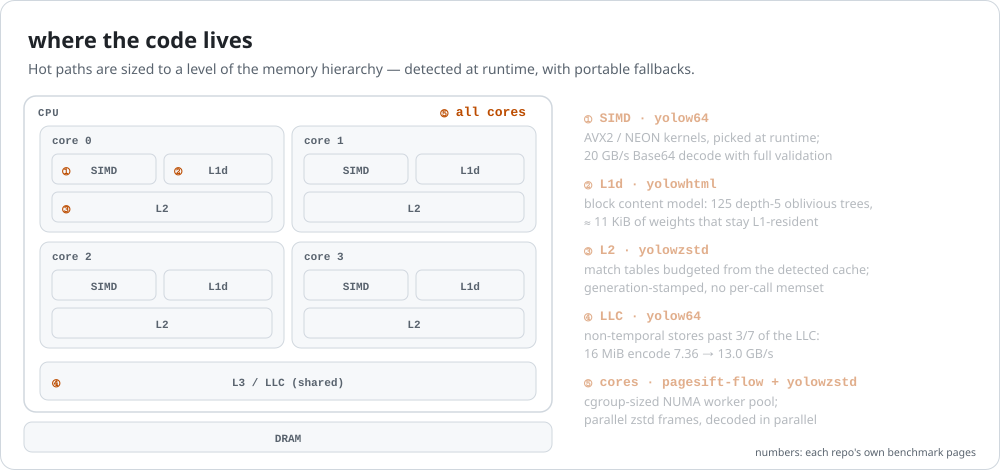

<picture>
  <source media="(prefers-color-scheme: dark)" srcset="assets/pipeline-dark.svg">
  
</picture>

  <a href="https://aiseek.dev">aiseek.dev</a> ·
  <a href="https://x.com/Ai__Seek">X @Ai__Seek</a> ·
  <a href="https://www.linkedin.com/in/yolow92">LinkedIn</a> ·
  <a href="#try-it--parse-a-page-from-this-profile">▶ try pagesift on any URL</a>

I build one stack: everything between raw bytes on the wire and evidence an AI can cite.
Parsers follow the spec first (WHATWG, ISO 32000, RFC 8878), statistics handle what authors get wrong,
and hot paths are sized to the hardware they run on. Pure Rust, no C toolchain.

## The stack

| | what it is | one number from its own benchmark |
|---|---|---|
| [**pagesift**](https://github.com/YOLOW92/pagesift)    | web & document ingestion engine: one binary with CLI, Firecrawl v1/v2 & Jina Reader HTTP APIs, MCP, Python, Node.js | HTML, PDF, Office, e-books, email, archives and 373 code languages in, Markdown / JSON / DataGraph out |
| [**yolowhtml**](https://github.com/YOLOW92/yolowhtml)    | zero-copy HTML5 parser, main-content extractor, Markdown engine | HTML → Markdown **0.24 ms/page** (Turndown 1.95 ms) |
| [**yolowpdf**](https://github.com/YOLOW92/yolowpdf)    | PDF → Markdown and a pure-Rust OCR engine; parses the format itself, no Poppler/MuPDF | run on olmOCR-bench (**1,269** pages) and the pdf.js corpus (**1,089** files) |
| [**yolowdoc**](https://github.com/YOLOW92/yolowdoc)    | Office, ODF, EPUB, email, SQLite and archives → Markdown | no native C dependencies |
| [**yolowsyntax**](https://github.com/YOLOW92/yolowsyntax)    | pure-Rust tree-sitter runtime, `#![forbid(unsafe_code)]` | **5,875 / 5,875** upstream corpus cases across 41 languages |
| [**yolow64**](https://github.com/YOLOW92/yolow64)    | Base64 with runtime-dispatched SIMD (AVX2 / NEON) | **20 GB/s** decode with full validation |
| [**yolowzstd**](https://github.com/YOLOW92/yolowzstd)    | Zstandard (RFC 8878), `#![forbid(unsafe_code)]`, zero dependencies | standard frames; multi-frame streams decode in parallel |

<picture>
  <source media="(prefers-color-scheme: dark)" srcset="assets/cpu-dark.svg">
  
</picture>

## The math underneath

Each project starts from a definition or a theorem, not a magic threshold.

**yolowpdf** — glyph positions come straight from the text rendering matrix in ISO 32000-2 §9.4.4:

$$
T_{rm} = \begin{bmatrix} T_{fs} T_h & 0 & 0 \\ 0 & T_{fs} & 0 \\ 0 & T_{rise} & 1 \end{bmatrix} \times T_m \times \mathit{CTM}
$$

**yolowhtml** — the block content model decides with an expected-F1-optimal threshold, then smooths the
labels with a DOM-LCA Viterbi pass (Vogels et al., 2018). The theorem behind the threshold: for calibrated
scores, the cut that maximises F1 is half the best achievable F1 (Lipton, Elkan & Naryanaswamy, 2014):

$$
\theta^\star = \tfrac{1}{2}\,F_1^\star
$$

**yolowzstd** — the Huffman literal coder works against Shannon's source-coding bound (Huffman, 1952):

$$
H(X) \le \bar{\ell} < H(X) + 1, \qquad H(X) = -\sum_x p(x) \log_2 p(x)
$$

**pagesift-stat** — when a source's grounding-hit or verification-success rate shifts, the run-length
posterior of Bayesian online change-point detection notices (Adams & MacKay, 2007):

$$
P(r_t, x_{1:t}) = \sum_{r_{t-1}} P(r_t \mid r_{t-1})\, P\!\left(x_t \mid r_{t-1}, x_t^{(r)}\right) P(r_{t-1}, x_{1:t-1})
$$

## Try it — parse a page from this profile

[**Open an issue with a URL →**](https://github.com/YOLOW92/YOLOW92/issues/new?template=try-pagesift.yml)
A GitHub Action runs **pagesift** on it and replies with the Markdown, usually within a minute.

Public `http(s)` pages only (private and loopback addresses are refused by pagesift's SSRF guard),
`robots.txt` is respected, three tries per account per day, and the reply shows the first 6,000 characters.

## Elsewhere

[**AiSeek**](https://aiseek.dev) — an evidence-graph product I design, build and run on my own
([showcase](https://github.com/YOLOW92/aiseek-showcase)).

Numbers in the table and the diagram come from each repository's own benchmark pages, measured on the author's machines.
The diagrams are generated by <code>scripts/render_svgs.py</code>.
